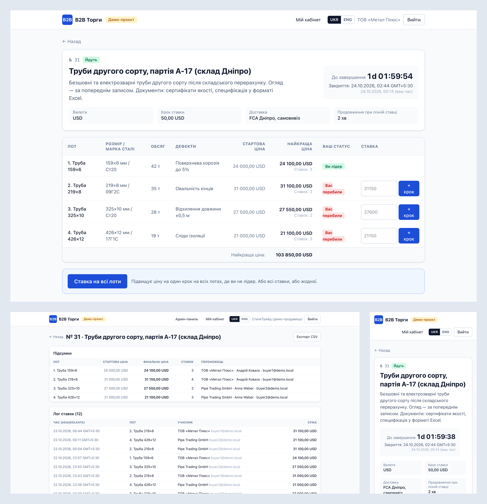
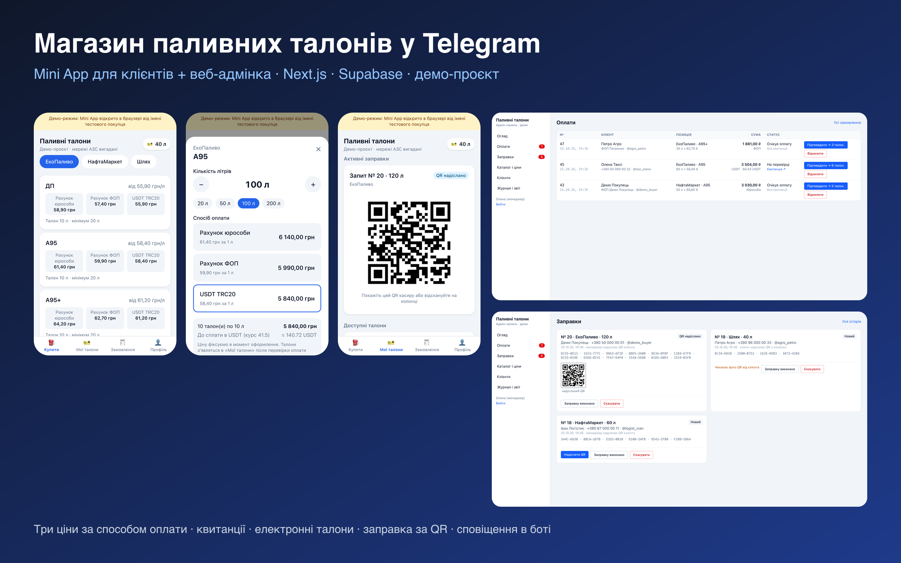
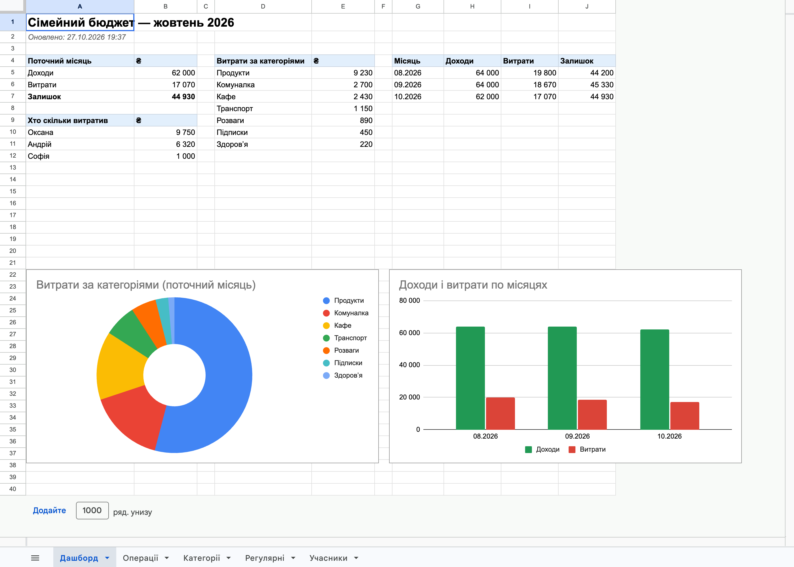

# Портфоліо — Роман Чеботарьов

Веб-застосунки, Telegram-боти й Mini App, інтеграції з API.
Стек: Next.js · React · TypeScript · Supabase (PostgreSQL) · Python · Telegram Bot API · Google Sheets API · Vercel.

Усі проєкти — робочі демо за мотивами реальних ТЗ: їх можна відкрити й випробувати.
Дані вигадані. Вихідний код зберігається в приватних репозиторіях — надаю доступ замовнику за запитом.

---

## [B2B-платформа онлайн-аукціонів](auction/)

Торги з кількома лотами, ставки в реальному часі, «ставка на всі лоти» однією транзакцією, антиснайпінг,
закриті торги за запрошенням, адмінка з логом ставок. UKR/ENG.
**[▶ Живе демо](https://b2b-auction-demo.vercel.app)** · [детальніше](auction/)

---

## [Магазин паливних талонів у Telegram Mini App](fuel-coupons/)

Mini App для клієнтів і веб-адмінка для менеджера: три ціни за способом оплати, квитанції,
електронні талони, заправка за QR, сповіщення через бота.
**[▶ Живе демо](https://fuel-coupon-shop-demo.vercel.app/app)** · [детальніше](fuel-coupons/)

---

## [Telegram-бот сімейного бюджету + Google Таблиця](family-budget-bot/)

Доходи й витрати кнопками в Telegram, спільна Google Таблиця з дашбордом і діаграмами,
регулярні платежі з нагадуваннями.
**[▶ Спробувати бота](https://t.me/roman_family_budget_demo_bot)** ·
**[📈 Дашборд](https://docs.google.com/spreadsheets/d/1rSm7pnCdSkde7iz9oH1tfem04f81yGdXV2Wvwqg1Z0w)** · [детальніше](family-budget-bot/)
