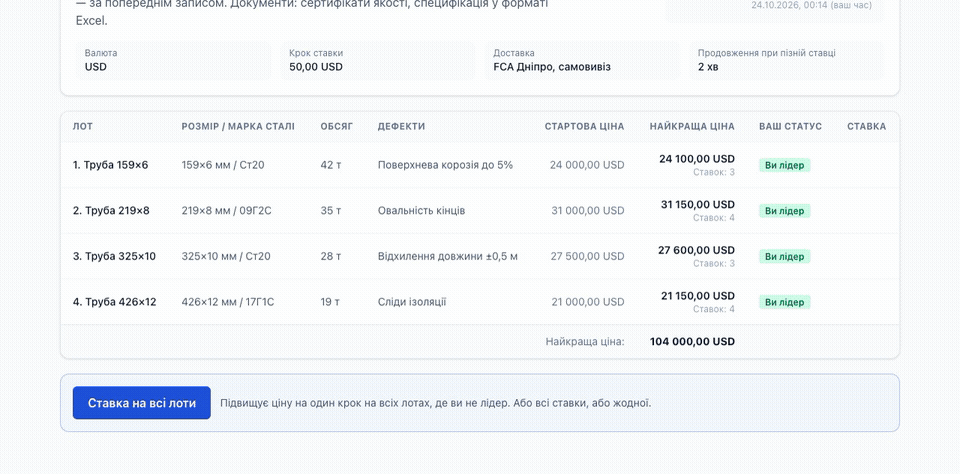
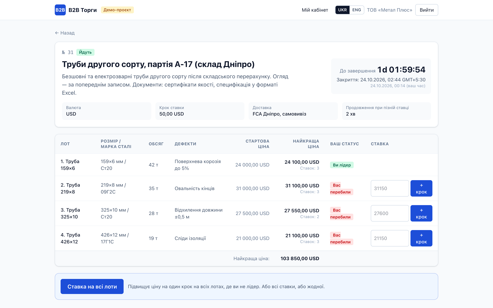
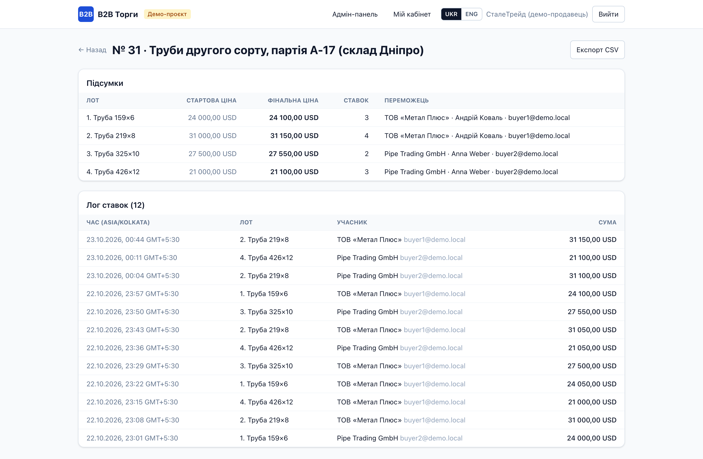
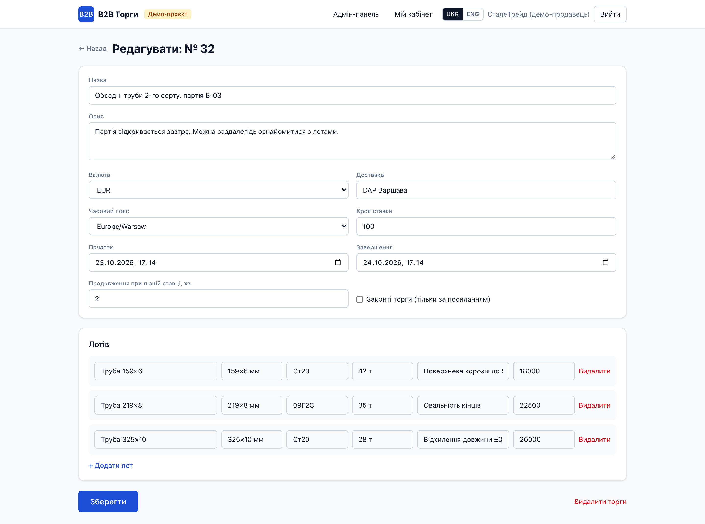
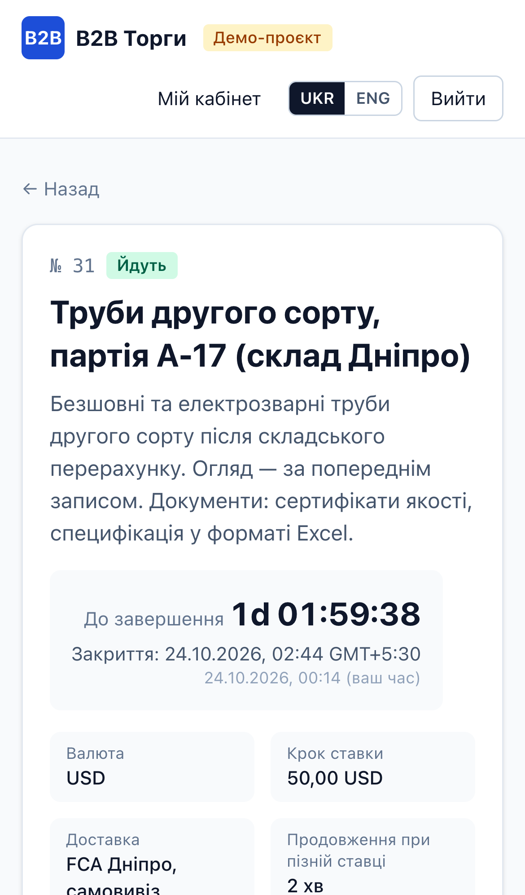

# B2B-платформа онлайн-аукціонів

Демо-проєкт за мотивами реального ТЗ: платформа для B2B-торгів трубами з кількома лотами в одних торгах.

**[▶ Відкрити живе демо](https://b2b-auction-demo.vercel.app)** — вхід одним кліком: кнопки «Покупець 1», «Покупець 2», «Адміністратор».
Щоб побачити ставки в реальному часі, відкрийте демо у двох вікнах під різними покупцями.

## Що вміє

- Ставки в реальному часі: ціна й статус «ви лідер / вас перебили» оновлюються без перезавантаження сторінки
- «Ставка на всі лоти» однією кнопкою — одна транзакція: або всі ставки, або жодної; лоти, де ви вже лідер, пропускаються
- Закриття за часовим поясом торгів, таймер — за часом сервера, а не браузера
- Антиснайпінг: ставка в останні хвилини продовжує торги
- Захист від одночасних ставок: з однакових ставок проходить рівно одна (блокування в базі даних)
- Закриті торги за посиланням-запрошенням
- Адмінка: створення й копіювання торгів, лог ставок, підсумки, експорт CSV
- Українська та англійська, адаптивна мобільна версія

| Сторінка торгів | Підсумки й лог ставок |
|---|---|
|  |  |
| **Форма торгів (адмінка)** | **Мобільна версія** |
|  |  |

## Як зроблено

Next.js (App Router) · Supabase: PostgreSQL, Realtime, Row Level Security · Vercel.
Уся логіка ставок — у функціях бази даних із блокуванням рядків, тож правила не обійти з браузера.
Логіка торгів покрита автотестами, зокрема тестом на 8 одночасних ставок.

Вихідний код — у приватному репозиторії, доступ надаю замовнику за запитом.
