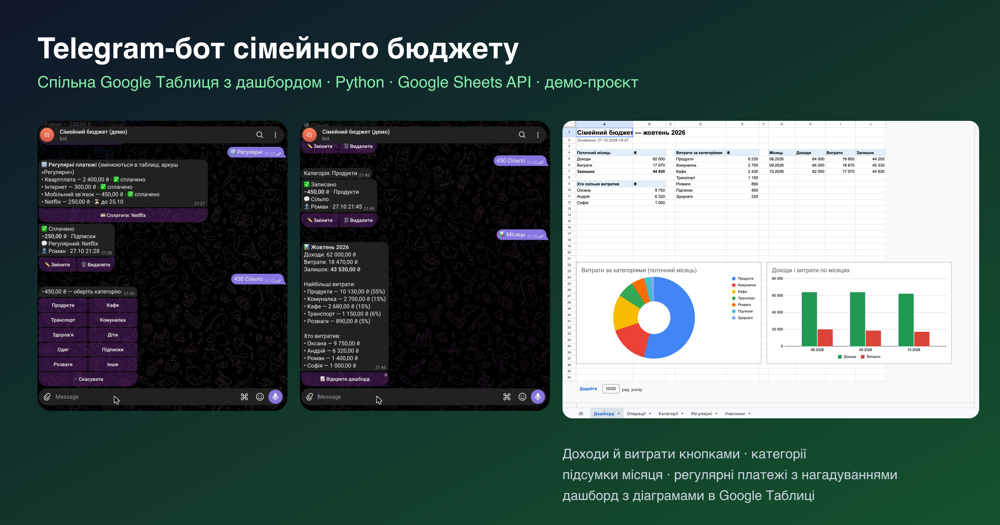
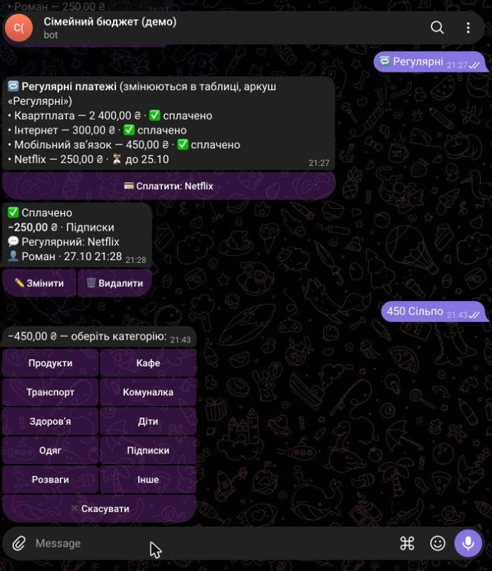
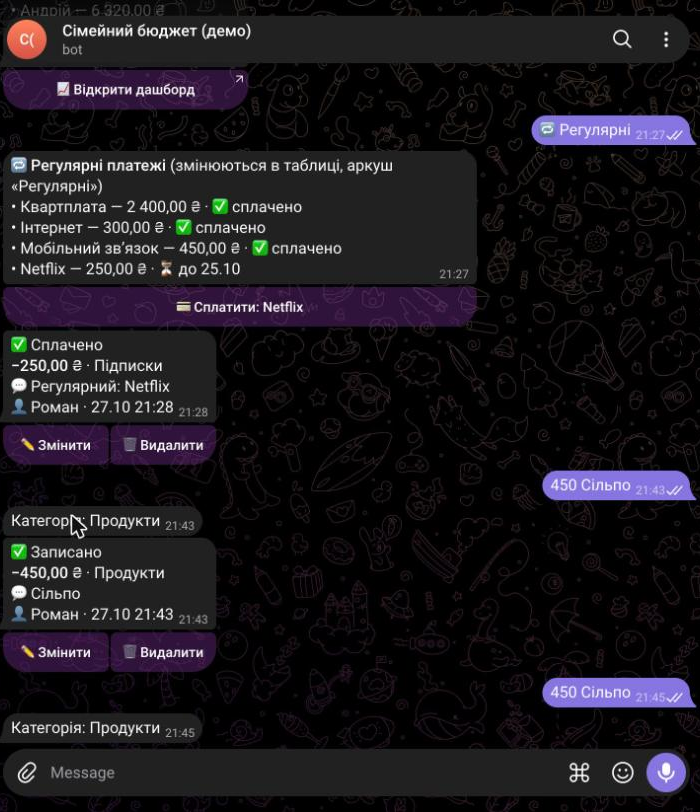
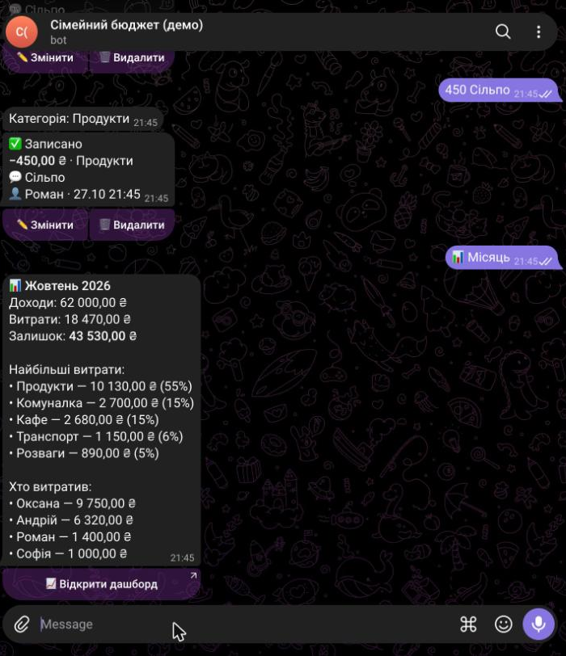

# Telegram-бот сімейного бюджету + Google Таблиця

Демо-проєкт за мотивами реального ТЗ: бот для спільного обліку доходів і витрат родини з автоматичним записом у Google Таблицю.

**[▶ Спробувати бота в Telegram](https://t.me/roman_family_budget_demo_bot)**
· **[📈 Відкрити таблицю з дашбордом](https://docs.google.com/spreadsheets/d/1rSm7pnCdSkde7iz9oH1tfem04f81yGdXV2Wvwqg1Z0w)** (лише перегляд)

У демо кожен бачить і змінює лише свої записи, а щоночі дані повертаються до початкового стану.

| Запис витрати й категорії | Запис збережено | Підсумки місяця |
|---|---|---|
|  |  |  |

## Що вміє

- Додавання доходів і витрат кнопками: сума → категорія → коментар; швидкий запис одним повідомленням — «250 кава»
- Хто додав запис — зберігається автоматично
- Редагування й видалення записів прямо з чату
- Підсумки місяця в боті: доходи, витрати, залишок, найбільші категорії, хто скільки витратив
- Спільна Google Таблиця: аркуші «Операції», «Категорії», «Регулярні», «Учасники» і «Дашборд» з діаграмами
- Регулярні платежі (комуналка, підписки) з нагадуваннями напередодні й у день оплати та кнопкою «Сплачено»
- Категорії й регулярні платежі змінюються в таблиці — без правок коду
- Захист від дублів: повторне натискання кнопки не створює другий запис
- Доступ лише для членів родини (список Telegram ID)

## Як зроблено

Python · python-telegram-bot · Google Sheets API (сервісний акаунт) · планувальник для нагадувань.
Дашборд перераховується після кожної зміни; логіка покрита автотестами.

Вихідний код — у приватному репозиторії, доступ надаю замовнику за запитом.
