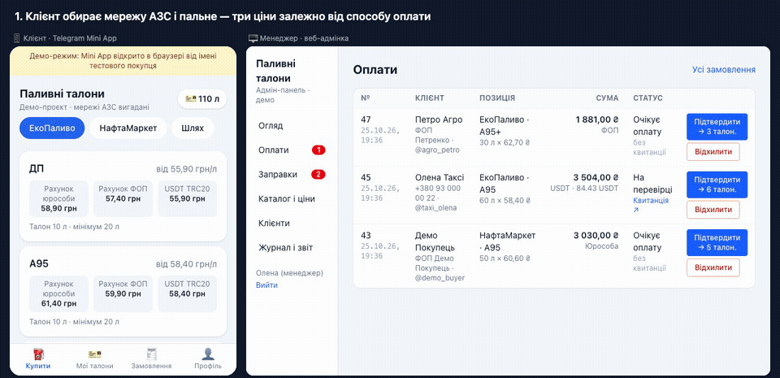
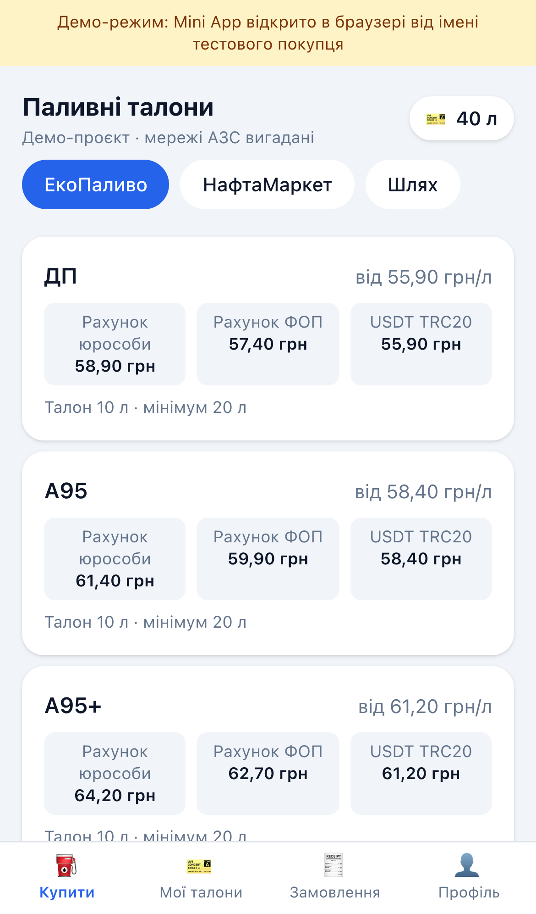
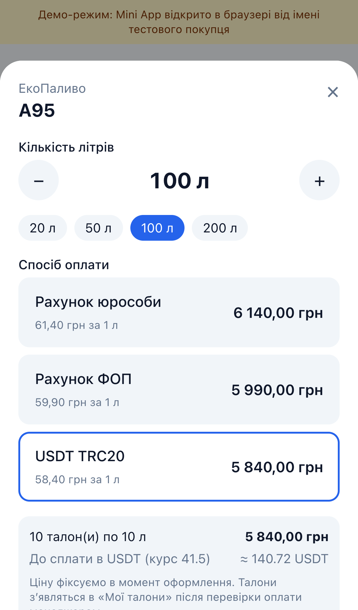
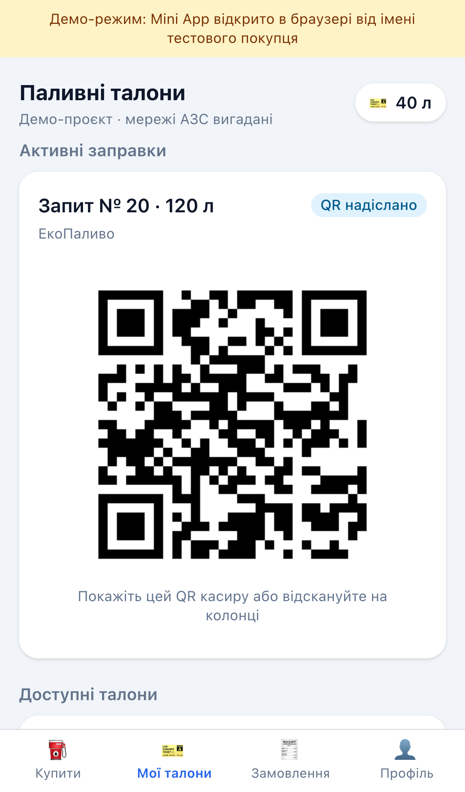
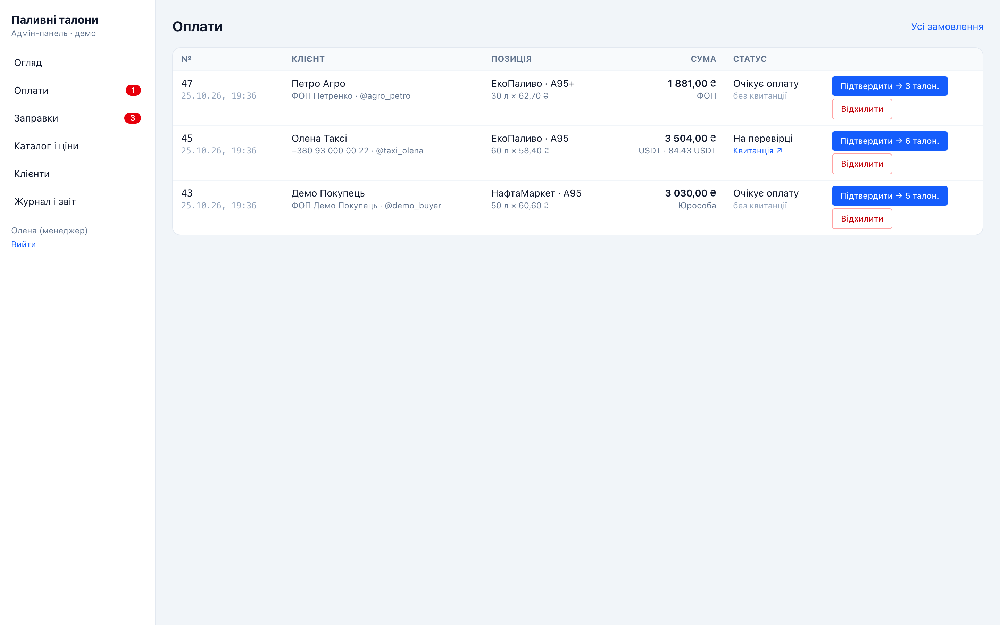
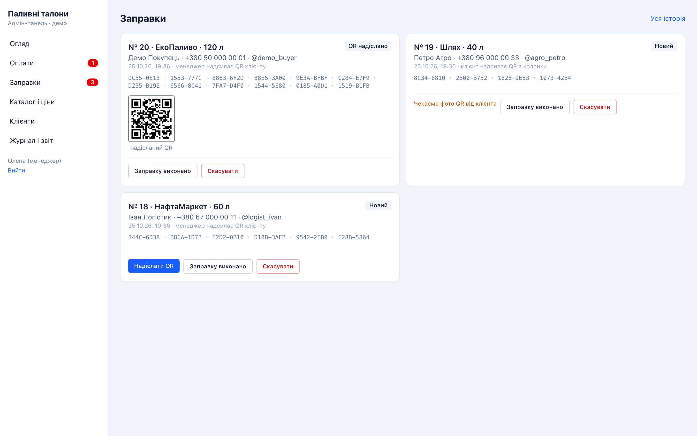

# Магазин паливних талонів у Telegram Mini App

Демо-проєкт за мотивами реального ТЗ: продаж електронних паливних талонів через Telegram Mini App і веб-адмінка для менеджера.
Мережі АЗС і ціни вигадані.

**[▶ Mini App у браузері](https://fuel-coupon-shop-demo.vercel.app/app)** — відкривається від імені тестового покупця
· **[▶ Адмінка](https://fuel-coupon-shop-demo.vercel.app/admin/login)** — кнопка «Увійти як демо-адміністратор»

Повний цикл: покупка → квитанція → підтвердження менеджером → талони → запит на заправку → QR:

## Що вміє

**Для клієнта (Mini App у Telegram)**
- Каталог за мережами АЗС і видами пального, три ціни залежно від способу оплати: рахунок юрособи, ФОП, USDT TRC20 за курсом
- Замовлення з мінімумом і кратністю номіналу талона; ціна фіксується в момент оформлення
- Реквізити й завантаження квитанції, статуси замовлення
- «Мої талони»: вибір талонів однієї мережі й запит на заправку; QR від менеджера або фото QR з колонки — залежно від мережі
- Вхід за підписом Telegram (initData) — без паролів

**Для менеджера (веб-адмінка)**
- Черга оплат із квитанціями, підтвердження й відхилення
- Заправки: надіслати QR, завершити, скасувати (талони повертаються клієнту)
- Каталог і ціни, курс USDT, клієнти з балансом і блокуванням, журнал дій, звіт продажів
- Сповіщення в Telegram про нові замовлення й оплати

| Каталог | Замовлення | QR для заправки |
|---|---|---|
|  |  |  |

| Оплати (адмінка) | Заправки (адмінка) |
|---|---|
|  |  |

## Як зроблено

Next.js · Supabase: PostgreSQL, Storage, Auth · Telegram Web Apps і Bot API (вебхук) · Vercel.
Талони резервуються з блокуванням рядків у базі — один талон не потрапить у два запити, а повторне підтвердження оплати не видасть талони вдруге.
Логіка покрита автотестами, зокрема тестом на 8 одночасних запитів з одним талоном.

Вихідний код — у приватному репозиторії, доступ надаю замовнику за запитом.
